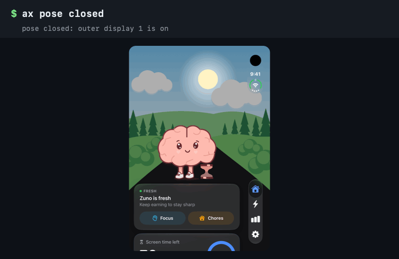

# devicehub-ax

Fold, rotate and tap the **iPhone Duo simulator** from the command line. `ax` drives Xcode 27's **Device Hub** and the app on the simulator through the macOS accessibility API. It is built for scripts and AI coding agents such as Claude Code and Codex, and it takes App Store screenshots of the inner display.

Xcode 27 replaced Simulator.app with Device Hub. Some simulator controls have no `simctl` or `devicectl` equivalent, such as the iPhone Duo poses (Closed, Partially Open, Open). Tools that inject touches, such as AXe and idb, land on the Duo's outer screen even when it is open. `ax` presses Device Hub's buttons and the app's own elements, on either screen, and confirms each action.

<p align="center"></p>

```bash
ax doctor                    # check access, Device Hub and the booted simulator
ax pose open                 # unfold the iPhone Duo; returns once the inner display is on
ax tap Progress              # press an element of the app by its label
ax wait "PAST 7 DAYS"        # wait for the next screen
ax screenshot progress.jpg   # the active display, ready for App Store Connect
```

- **No private frameworks.** It uses the accessibility API, `simctl` and `devicectl` only.
- **Confirmed actions.** `pose` and `rotate` wait until devicectl reports the new state, and fail with exit code 5 if it never arrives.
- **Made for agents.** Every command takes `--json`, and each kind of failure has its own exit code. A failed `tap` lists the closest labels on the screen, and when a label matches two different elements, `ax` reports both instead of picking one.

Coding agents: read [AGENTS.md](AGENTS.md), or install the skill with `npx skills add hipporasy/devicehub-ax`.

The [wiki](https://github.com/hipporasy/devicehub-ax/wiki) has the full command reference, JSON fields, troubleshooting, an App Store screenshot script and a comparison with similar tools.

## Install

### Download

Grab `ax-macos-universal.zip` from the [latest release](https://github.com/hipporasy/devicehub-ax/releases/latest) (Apple silicon and Intel, macOS 13 or later):

```bash
curl -fL -o ax.zip https://github.com/hipporasy/devicehub-ax/releases/latest/download/ax-macos-universal.zip
unzip ax.zip && xattr -d com.apple.quarantine ax 2>/dev/null
mv ax /usr/local/bin/   # or mkdir -p ~/.local/bin && mv ax ~/.local/bin/
```

The binary is ad-hoc signed, not notarized. Downloads made with `curl` are not quarantined; one saved from a browser is, which is what the `xattr` line clears.

### Build from source

Needs Swift 5.9 or later (Xcode's toolchain is fine).

```bash
git clone https://github.com/hipporasy/devicehub-ax.git
cd devicehub-ax
swift build -c release
cp .build/release/ax /usr/local/bin/   # or anywhere on your PATH
```

Then give the terminal app you run it from (Terminal, iTerm, Ghostty, your IDE) **Accessibility** access: System Settings > Privacy & Security > Accessibility. `ax` asks for it on first run.

## Usage

```
ax doctor                       check access, Device Hub, its windows and booted simulators
ax state                        device, pose, orientation and displays
ax pose closed|partial|open     fold or unfold an iPhone Duo, confirmed
ax rotate [TIMES]               press Rotate Right, confirmed
ax screenshot PATH              capture the active display (--display inner|outer|ID)
ax controls | control LABEL     list or press Device Hub's buttons under the device
ax screen                       list the elements on the device's screen
ax tap LABEL                    press one of them
ax wait LABEL [--gone]          wait until it appears, or disappears
ax list | press LABEL           the raw accessibility tree of any app (--app, --pid)
```

Options: `--json`, `--device UDID|name` (or `AX_DEVICE`), `--timeout SECS`, `--contains`, `--role ROLES`, `--no-verify`. Run `ax --help` for the full list and the exit codes.

`tap` and `wait` only look at the device's screen, so an app's Home tab never clashes with Device Hub's Home button. Device Hub must have the device's window on screen: a minimised window, a window on another Space, or a locked Mac hides it from the accessibility API.

## Recipe: iPhone Duo screenshots of the inner display

```bash
xcrun simctl status_bar booted override --time 9:41 --batteryState charged --batteryLevel 100
ax pose open
ax tap Home && ax wait "THIS WEEK" && ax screenshot shots/home.jpg   # 2853 x 2007
ax pose closed && ax screenshot shots/cover.jpg                      # 1398 x 2034
```

App Store Connect takes the inner display as the `APP_IPHONE_DUO` display type (2853 x 2007 or 2007 x 2853) and rejects images with an alpha channel. `ax screenshot` writes none: a `.jpg` path gives JPEG at quality 0.95, any other path gives PNG.

## Notes

- Tested with Xcode 27.1 (Device Hub) on macOS 27.
- Device Hub reports a process ID of -1 to `NSWorkspace`, so `ax` finds it in the process table by executable name.
- Swipes from tools such as AXe or `idb` land on the Duo's outer display; use accessibility presses for the inner display.
- `ax tap` performs the accessibility press, so it cannot swipe, scroll or type.
- devicectl reports no hinge angle, so `ax state` shows Partially Open and Open both as `unfolded`.

## License

MIT
